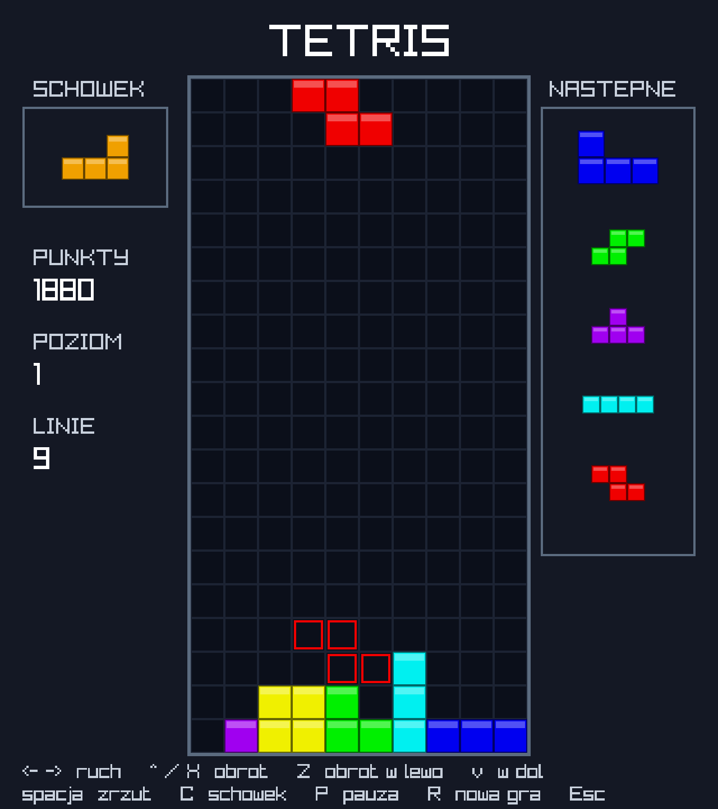
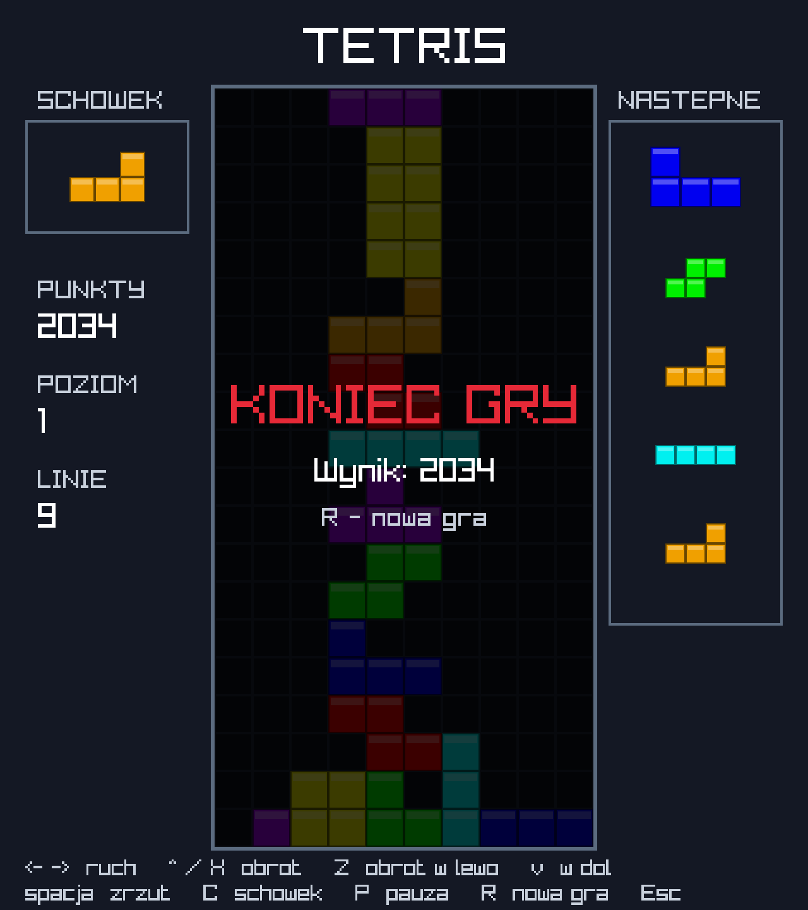

# Tetris w Ducklingu

Tetris napisany w Ducklingu, z zasadami według **Tetris Guideline**, czyli specyfikacji, której trzymają się oficjalne gry Tetris od 2001 roku. Okno, klawiatura i rysowanie korzystają z pakietu `grafika` (raylib 5.5) z [duckling-biblioteki](https://github.com/andr729/duckling-biblioteki).





## Sterowanie

| Klawisz | Działanie |
|---|---|
| ← → | ruch w bok (przytrzymanie: po 0,17 s klocek sunie co 0,05 s) |
| ↑ albo X | obrót w prawo |
| Z | obrót w lewo |
| ↓ | miękki zrzut (20 razy szybciej, 1 punkt za wiersz) |
| spacja | twardy zrzut (2 punkty za wiersz, od razu blokuje) |
| C albo lewy Shift | schowek (raz na klocek) |
| P | pauza |
| R | nowa gra |
| Esc albo zamknięcie okna | wyjście |

## Zasady (Tetris Guideline)

* **Plansza:** 10 kolumn × 20 widocznych wierszy, nad nią 2 ukryte. Klocek wchodzi w dwóch górnych widocznych wierszach, wyśrodkowany; klocki szerokie na 3 pola są przesunięte w lewo.
* **Klocki:** 7 rodzajów (I, O, T, S, Z, J, L) w kolorach z Guideline.
* **Obroty: Super Rotation System (SRS).** Gdy obrót nie mieści się w miejscu, gra próbuje kolejno 4 przesunięć z tabel SRS (osobna tabela dla I). O się nie przesuwa.
* **Losowanie „7-bag”:** każde kolejne 7 klocków to wszystkie rodzaje w losowej kolejności.
* **Podgląd i schowek:** widać 5 następnych klocków, a ze schowka można skorzystać raz na klocek.
* **Cień:** obrys pokazuje, gdzie klocek wyląduje.
* **Opóźnienie blokady:** leżący klocek blokuje się po 0,5 s. Ruch albo obrót odnawia ten czas najwyżej 15 razy; licznik zeruje się, gdy klocek zejdzie niżej.
* **Punkty:** za 1 / 2 / 3 / 4 linie naraz 100 / 300 / 500 / 800 razy poziom, do tego 1 punkt za wiersz miękkiego zrzutu i 2 za wiersz twardego.
* **Poziomy i prędkość:** poziom rośnie co 10 linii. Czas spadku o jeden wiersz to (0,8 − (poziom − 1) × 0,007)^(poziom − 1) sekund, jak w Tetris Worlds: poziom 1 to 1 s, poziom 10 to 0,064 s, poziom 15 to 0,007 s.
* **Koniec gry:** nowy klocek nie ma miejsca (block out) albo klocek zablokuje się cały nad widoczną planszą (lock out).

Bez T-spinów, combo i premii back-to-back. To możliwe rozszerzenia.

## Uruchomienie (macOS)

```sh
./uruchom.sh          # pierwszy raz przygotowuje raylib i pakiet grafika (~1 min), potem buduje i uruchamia grę
./uruchom.sh testy    # testy logiki, bez okna
```

Wymagania:
* Duckling z `duck` w PATH (sprawdzone na `duckc 0.3-alpha (83882805a 2026-11-20)`, macOS 27.2, Apple Silicon);
* Xcode Command Line Tools (git, make, clang);
* repozytorium duckling-biblioteki, gałąź `paczki-duck`, domyślnie w `~/duckling-biblioteki` (inna ścieżka: `./przygotuj_macos.sh /ścieżka`).

### Gotowy build (macOS, Apple Silicon)

W repozytorium jest zbudowana gra: `gra/.duck_build/dev/tetris_gra` razem z biblioteką `libraylib.dylib` (raylib 5.5, licencja zlib/libpng w `LICENSE-raylib.txt`). Plik gry szuka raylib obok siebie (`@executable_path`), więc nie potrzebuje Ducklinga, `zewnetrzne/` ani konkretnej ścieżki repozytorium:

```sh
gra/.duck_build/dev/tetris_gra
```

Po pobraniu repozytorium jako ZIP (zamiast `git clone`) macOS może zablokować nieznany program; wtedy jednorazowo: `xattr -dr com.apple.quarantine gra/.duck_build`. Uwaga: `./uruchom.sh` buduje grę od nowa w tym samym katalogu i nadpisuje plik gry wersją, która korzysta z raylib w `zewnetrzne/`.

## Struktura

```
logika/   pakiet tetris_logika: zasady gry (plansza, SRS, 7-bag, schowek, blokada, punkty), bez okna
gra/      pakiet tetris_gra: okno, klawiatura, rysowanie, pętla gry
testy/    pakiet testy_tetrisa: 54 sprawdzenia logiki, kod wyjścia = liczba błędów
zrzuty/   obrazy do README: TETRIS_ZRZUTY=1 gra/.duck_build/dev/tetris_gra
          (prosty automat układa 26 klocków, potem gra dochodzi do końca)
przygotuj_macos.sh   raylib 5.5 i kopia pakietu grafika dla macOS do zewnetrzne/ (poza gitem)
```

Testy sprawdzają między innymi:
* kształty i 4 obroty każdego klocka;
* odbicia SRS przy ścianach, np. T przy lewej ścianie i I przy prawej, policzone ręcznie z tabel;
* to, że każde 7 kolejnych klocków to komplet;
* punktację single i tetrisa oraz przejście na 2. poziom po 10. linii;
* czasy grawitacji dla poziomów 1, 10 i 15;
* opóźnienie blokady z limitem 15 odnowień;
* schowek, oba rodzaje końca gry i przytrzymanie strzałki.

## Pułapka Ducklinga znaleziona przy pisaniu

**`let x = lista.at(i)` nie kopiuje elementu, tylko tworzy do niego alias.** Zamiana dwóch elementów listy przez `let` psuje dane (`[1..7]` po zamianie dało `1 2 3 4 5 6 3`). Gdy lista zostanie potem podmieniona, alias wskazuje na zwolnioną pamięć: w workach 7-bag pojawiały się zera. Kopię dają `var x: i32 = lista.at(i)`, odczyt pola `let y = lista.at(i).pole` albo wyrażenie `let x = lista.at(i) + 0`. W `logika/` wszystkie takie miejsca używają `var` z typem.

Ta pułapka uzupełnia listę `dokumentacja/PULAPKI-DUCKLINGA.md` z duckling-biblioteki, podobnie jak wcześniej znalezione: `restart` jest słowem kluczowym, a `gra.setGravity` nie budzi uśpionych ciał.

`duck` trzyma jedno środowisko (venv) na nazwę pakietu. Druga kopia projektu na tym samym komputerze kończy się błędem „would overwrite the venv”: zmień w niej `name` w `quackconfig.yaml` albo dodaj `--overwrite`.

## Źródła zasad

* [Tetris Guideline (Hard Drop Wiki)](https://harddrop.com/wiki/Guideline)
* [Super Rotation System (TetrisWiki)](https://tetris.wiki/Super_Rotation_System): tabele przesunięć SRS
* [Wymiary planszy i strefa ukryta (Hard Drop Wiki)](https://www.harddrop.com/wiki/Playfield)
* [Punktacja Guideline (StrategyWiki)](https://strategywiki.org/wiki/Tetris/Scoring)
* [Krzywa prędkości i opóźnienie blokady](https://gamertagmythras.com/blog/tetris/tetris-gravity-and-lock-delay-guide)

## Licencja

MIT. Kopia pakietu `grafika` w `zewnetrzne/` pochodzi z duckling-biblioteki (MIT), a raylib ma licencję zlib. „Tetris” jest znakiem towarowym The Tetris Company; to projekt edukacyjny.
